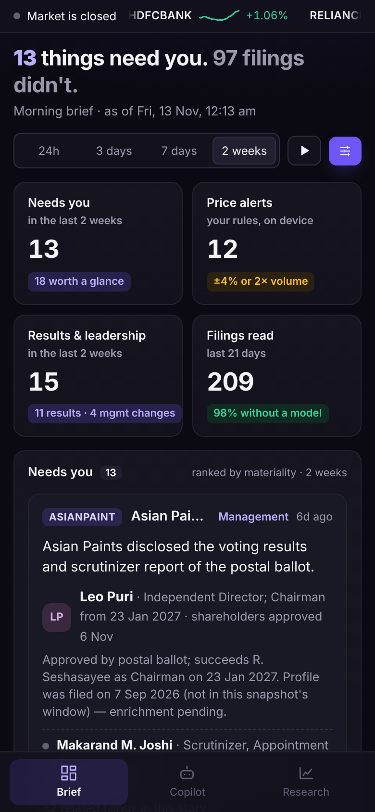
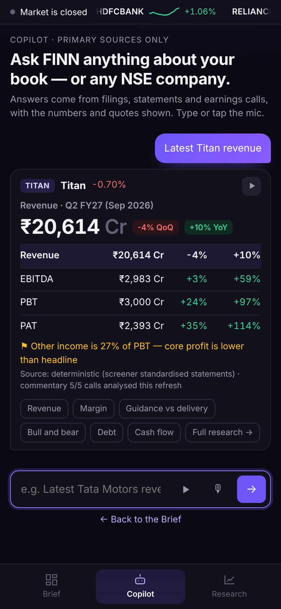
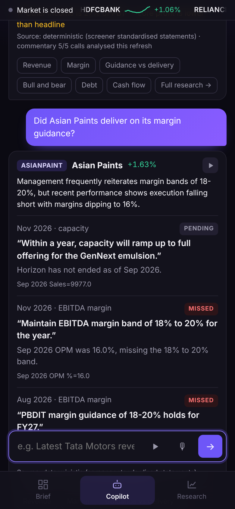
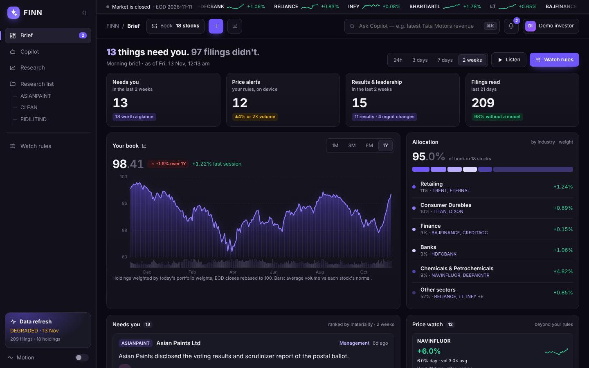
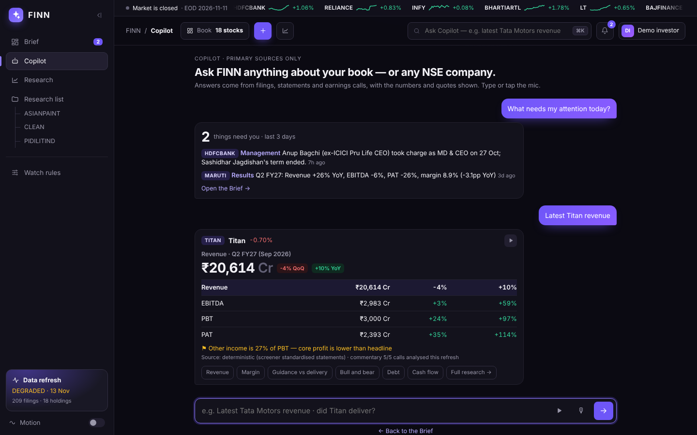

# FINN — a financial investment agent that filters, and answers from the source

FINN is a mobile-first agent for a public-markets investor, in two modes plus one way to talk to it:

- **Brief (Push):** every exchange filing across the portfolio for a window you choose (24h by default), classified,
  scored and clustered into stories. At most five full cards; the rest is compressed into one-liners or filed away.
  Results arrive as Revenue / EBITDA / PBT / PAT, QoQ and YoY; management changes arrive with who the new person is
  and where they came from. End-of-day price and volume alerts run against *your* thresholds, on the phone.
- **Research (Pull):** a dossier on **any NSE ticker**, built only from primary sources (statements from filings,
  concall transcripts): business and financial snapshot, trajectory, balance sheet, cash quality,
  **promised vs delivered** with every quote checked against the transcript, narrative vs numbers, bull vs bear.
- **Copilot (the interaction model):** one box — type or speak — for the whole product. "What needs my attention
  today?", "latest Tata Motors revenue", "did Asian Paints deliver on margin guidance?", "why did Bajaj Finance
  move?". Number questions are answered from computed figures with no model call; open questions get a model answer
  that may only use the company's own facts and must cite them.

**Live:** `<your GitHub Pages URL>` · Architecture: [docs/architecture.md](docs/architecture.md) · Write-up: [WRITEUP.md](WRITEUP.md)

| Brief | Copilot | Promised vs delivered |
|---|---|---|
|  |  |  |

On a laptop the same app opens as a dashboard:




## Repository

```
backend/finn/          Python: sources (BSE, NSE, screener, prices, PDFs), intel (classify, materiality,
                       results, people, fundamentals, transcripts, research), llm router, snapshot job, API
backend/tests/         tests against real captured payloads (no network, no model)
data/portfolio.json    mock portfolio (18 names) + research list
data/companies.json    org registry: names and aliases (to recognise companies in questions)
data/raw/              captured source payloads + build-time model outputs (llm_seed/)
web/                   React + Vite PWA (Copilot: web/src/screens/Copilot.tsx)
.github/workflows/     daily refresh (cron) and Pages deploy
```

## Run it locally

```bash
# backend (Python 3.11+)
pip install -r backend/requirements.txt
cd backend
FINN_OFFLINE=1 python -m finn refresh      # rebuild the snapshot from data/raw captures, no network needed
python -m pytest -q                        # 41 tests: real filings + a fake Gemini that misbehaves
export GEMINI_API_KEY=...                  # free key: https://aistudio.google.com/apikey
python -m finn refresh                     # live: prices, filings, fundamentals, LLM enrichment
python -m finn research DIXON              # one dossier for any NSE symbol
python -m finn serve                       # research + Copilot API on :8000

# app
cd ../web && npm install
npm run dev                                 # http://localhost:5173
VITE_API_BASE=http://localhost:8000 npm run dev   # enables live Pull for any ticker
```

## Deploy (all free tiers)

1. **Push to GitHub** (public repo).
2. **App → GitHub Pages:** repo *Settings → Pages → Source: GitHub Actions*. Every push to `main` builds `web/` and
   publishes it (`.github/workflows/pages.yml`).
3. **Daily refresh:** add repo secret `GEMINI_API_KEY` (*Settings → Secrets and variables → Actions*). The
   `refresh-snapshot` workflow runs at 16:15 IST on weekdays; run it once by hand from the *Actions* tab.
4. **Live research + Copilot API:** on render.com create a Docker web service from this repo
   (`backend/Dockerfile`, context `.`, free instance, env `GEMINI_API_KEY`). Then add a repo *variable*
   `FINN_API_BASE` = the Render URL and re-run the Pages workflow. Without it the app still works on the
   pre-built dossiers, and Copilot answers number questions offline.

## Notes

- Prices, filings, statements and transcripts are real. Model-written parts come from Gemini in the daily refresh.
  For Asian Paints and Clean Science there is also a build-time analysis (`data/raw/llm_seed/`, written by Claude
  with the pipeline's own prompts and schemas), shown only when a live run didn't finish and labelled
  "Build-time analysis".
